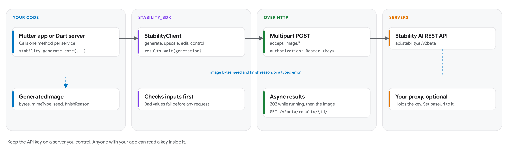
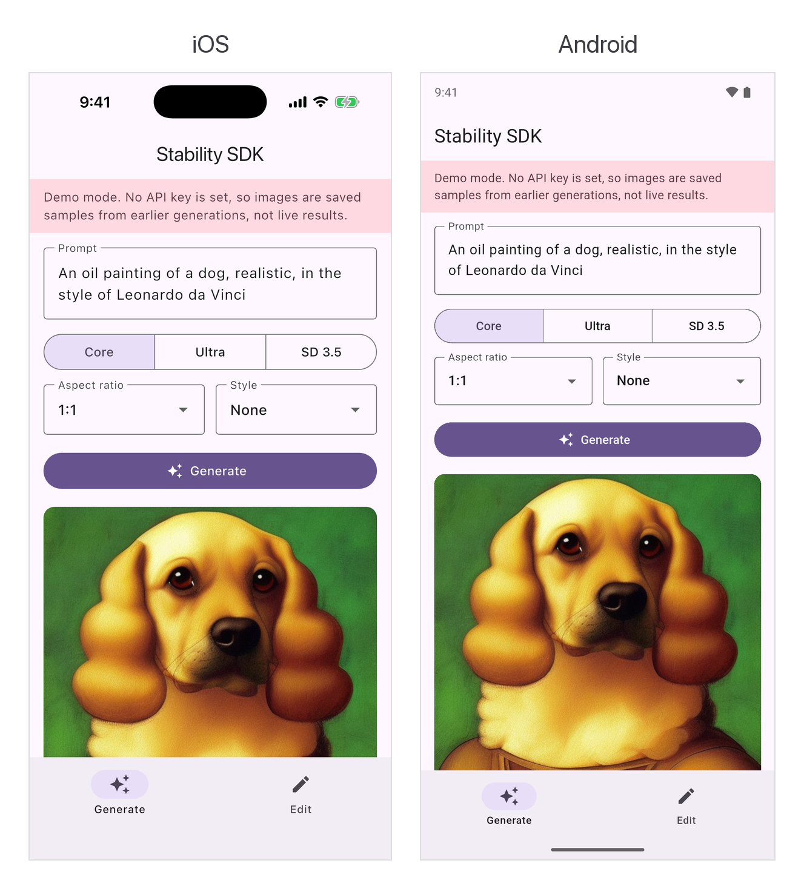
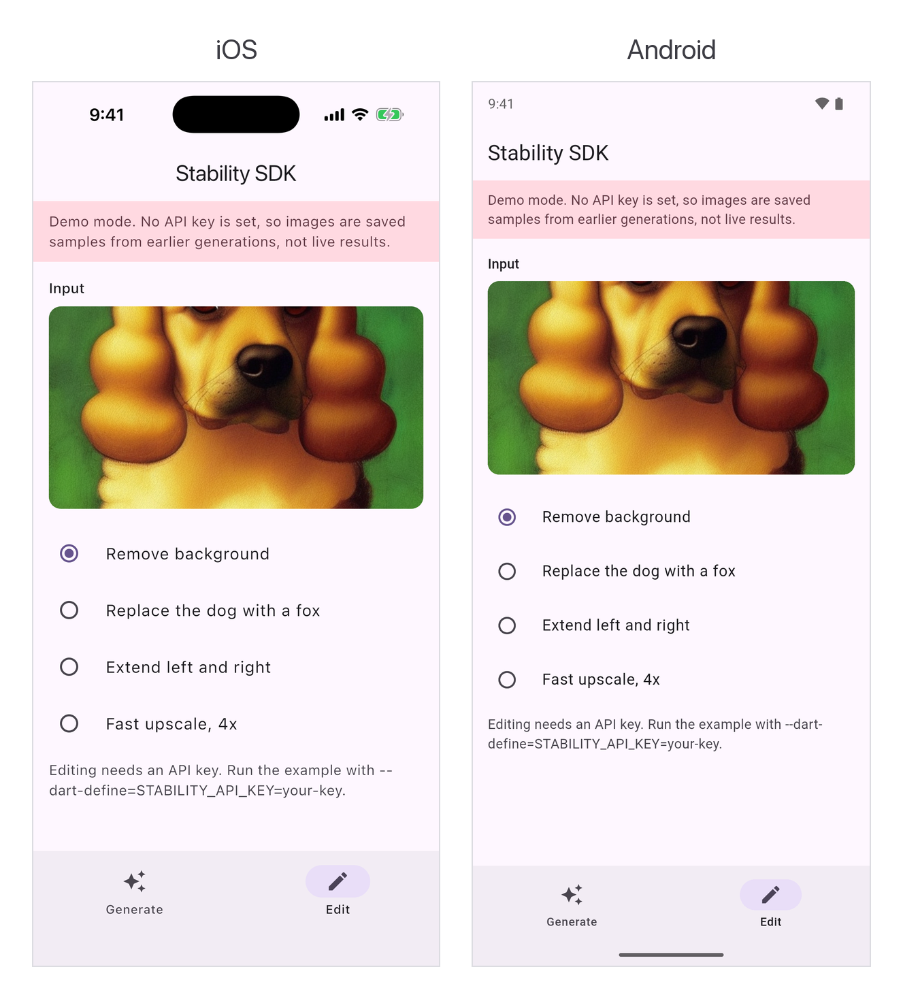

# stability_sdk

[](https://pub.dev/packages/stability_sdk)

A Dart client for the [Stability AI](https://stability.ai) REST API. Generate, edit, upscale and control images with Stable Image and Stable Diffusion 3.5, from a Flutter app or a Dart server.



## Features

| Service | Methods |
|---|---|
| Generate | `generate.ultra`, `generate.core`, `generate.sd35` (text to image and image to image) |
| Upscale | `upscale.fast`, `upscale.conservative`, `upscale.creative` (async) |
| Edit | `edit.erase`, `edit.inpaint`, `edit.outpaint`, `edit.searchAndReplace`, `edit.searchAndRecolor`, `edit.removeBackground`, `edit.replaceBackgroundAndRelight` (async) |
| Control | `control.sketch`, `control.structure`, `control.style`, `control.styleTransfer` |
| Results | `results.fetch`, `results.wait` for async services |

- **Pure Dart.** No Flutter dependency, so it runs in apps, on servers and in scripts.
- **Typed options and errors.** Enums for aspect ratios, styles and formats, and one exception class per API error.
- **Checks inputs first.** Empty prompts, out-of-range values and invalid combinations fail with a clear error before a request is sent.
- **Testable.** Pass your own `http.Client`.
- **Works on the web.** Browsers hide the `seed` and `finish-reason` headers, so on the web the SDK asks for JSON, which carries both.

## Installation

```bash
dart pub add stability_sdk
```

Create an API key on the [Stability AI platform](https://platform.stability.ai/dashboard/api-keys). Each request uses credits. See [pricing](https://docs.stability.ai/pricing). Failed requests are not charged.

## API version

This package uses Stability AI's REST API under `/v2beta`, the API that all current models and services run on. Stability AI still labels it beta, and there is no stable `/v2` yet, so this package stays below 1.0. Expect a minor version bump (for example 0.2 to 0.3) when the API changes in a way that breaks your code. A `^0.2.0` constraint will not pick that up by itself.

The older `/v1` REST endpoints and the gRPC API are not used. Version 0.1 of this package used the gRPC API.

## Keep your API key safe

Anyone who has your app can read an API key that ships inside it. For a published app, call Stability AI from your own backend, and point the SDK at that backend with `baseUrl`. Your backend adds the real key. Only put a key in an app for local testing.

```dart
final stability = StabilityClient(
  apiKey: userSessionToken, // checked by your backend, not by Stability AI
  baseUrl: Uri.parse('https://api.example.com/stability'),
);
```

Your backend should:

- Check who is calling, and rate-limit each user. Otherwise anyone can spend your credits through it.
- Forward the `accept` header, and send back the `content-type`, `seed` and `finish-reason` headers.

The SDK never includes the key in `toString`, logs or error messages.

## Quick start

```dart
import 'dart:io';

import 'package:stability_sdk/stability_sdk.dart';

Future<void> main() async {
  final stability = StabilityClient(
    apiKey: Platform.environment['STABILITY_API_KEY']!,
  );

  final image = await stability.generate.core(
    prompt: 'A lighthouse on a cliff at sunrise',
    aspectRatio: ImageAspectRatio.ratio16x9,
    stylePreset: StylePreset.photographic,
  );

  await File('lighthouse.png').writeAsBytes(image.bytes);
  print('Seed: ${image.seed}');

  stability.close();
}
```

`image.bytes` is the encoded image in the format you asked for. Pass `image.seed` back as `seed` to get a similar image again. If `image.isFiltered` is true, the content filter blurred the image.

## Generate

```dart
// The highest quality.
final ultra = await stability.generate.ultra(prompt: 'A red fox in the snow');

// Stable Diffusion 3.5, text to image.
final sd = await stability.generate.sd35(
  prompt: 'A red fox in the snow',
  model: Sd35Model.largeTurbo,
  negativePrompt: 'blurry',
);

// Image to image. strength is required: 0 keeps the image, 1 ignores it.
final variation = await stability.generate.sd35(
  prompt: 'The same fox, in watercolor',
  image: sd.bytes,
  strength: 0.6,
);
```

`Sd35Model` has constants for every model the docs list. `Sd35Model.flash` is in the docs and pricing, though not yet in the API's published model list. For a model this version doesn't list yet, use `Sd35Model('model-name')`.

## Edit

```dart
final cutout = await stability.edit.removeBackground(image: photo);

final swapped = await stability.edit.searchAndReplace(
  image: photo,
  searchPrompt: 'dog',
  prompt: 'a red fox',
);

final wider = await stability.edit.outpaint(image: photo, left: 256, right: 256);

// Masks are black and white. White is changed, black is kept.
final patched = await stability.edit.inpaint(
  image: photo,
  mask: mask,
  prompt: 'a straw hat',
);
```

## Upscale

```dart
final bigger = await stability.upscale.fast(image: photo);
```

Creative Upscale and Replace Background and Relight run in the background. They return an `AsyncGeneration`. Wait for it with `results.wait`, which checks every 10 seconds:

```dart
final job = await stability.upscale.creative(image: photo, prompt: 'a sharp photo');
final upscaled = await stability.results.wait(job);
```

Or check yourself with `results.fetch`, which returns `GenerationInProgress` or `GenerationComplete`. Results are kept for 24 hours.

## Control

```dart
final castle = await stability.control.sketch(
  image: sketch,
  prompt: 'A castle on a hill, digital art',
  controlStrength: 0.7,
);

final restyled = await stability.control.styleTransfer(
  initImage: photo,
  styleImage: painting,
);
```

## Errors

API errors throw a subclass of `StabilityException`, with the status code, the error `id` for support, and the API's messages:

```dart
try {
  await stability.generate.core(prompt: prompt);
} on ContentModerationException {
  // 403. The prompt or image was flagged.
} on RateLimitException {
  // 429. 150 requests per 10 seconds, then blocked for 60 seconds.
} on InsufficientCreditsException {
  // 402. Buy more credits.
} on StabilityException catch (e) {
  print('${e.statusCode} ${e.name}: ${e.errors.join(', ')} (id ${e.id})');
}
```

| Status | Exception |
|---|---|
| 400 | `BadRequestException` |
| 401 | `UnauthorizedException` |
| 402 | `InsufficientCreditsException` |
| 403 | `ContentModerationException` |
| 404 | `NotFoundException` |
| 413 | `PayloadTooLargeException` |
| 422 | `UnprocessableException` |
| 429 | `RateLimitException` |
| 500 and others | `ServerException` |

Invalid arguments throw `ArgumentError` or `RangeError` before any request. Network failures throw `http.ClientException`.

## Testing your code

Pass an `http.Client` to control responses, for example `MockClient` from `package:http/testing.dart`:

```dart
final stability = StabilityClient(
  apiKey: 'test',
  httpClient: MockClient((request) async => http.Response.bytes(
        pngBytes,
        200,
        headers: {'content-type': 'image/png', 'finish-reason': 'SUCCESS'},
      )),
);
```

## Example app

The [example](example) is a Flutter app with a Generate tab and an Edit tab.

```bash
cd example
flutter run --dart-define=STABILITY_API_KEY=your-key
```

Without a key it runs in demo mode. It never calls the API, and the Generate tab shows saved 512 by 512 images from Stability's older Stable Diffusion 2 engine, made with version 0.1 of this package. They are not Core, Ultra or SD 3.5 output. Editing needs a key.

| Generate | Edit |
|---|---|
|  |  |

## Migrating from 0.1

Version 0.2 is a rewrite for Stability AI's current REST API, which is still in beta (v2beta). Versions 0.1 and earlier used the older gRPC API, which no longer gets new models or features.

| 0.1 | 0.2 |
|---|---|
| `StabilityApiClient.init(key)` | `StabilityClient(apiKey: key)` |
| `RequestBuilder(prompt)...build()` and `client.generate(request).listen(...)` | `await stability.generate.core(prompt: prompt)` |
| `answer.artifacts?.first.getImage()` | `image.bytes` |
| `EngineType` | `generate.ultra`, `generate.core` or `generate.sd35` with `Sd35Model` |

The package also no longer depends on Flutter, `grpc` or `protobuf`.

## Development

```bash
dart test                       # the package, with a fake API
cd example && flutter test      # the example app in demo mode
```

The tests never call the real API, and need no key. CI runs both, plus `dart analyze` and a publish dry run, on every pull request.

## Not covered yet

Stable Audio, 3D, the v1 SDXL endpoints and the account and balance endpoints are not supported. See the [API reference](https://docs.stability.ai/api-reference).

## License

BSD 3-Clause. See [LICENSE](LICENSE).
